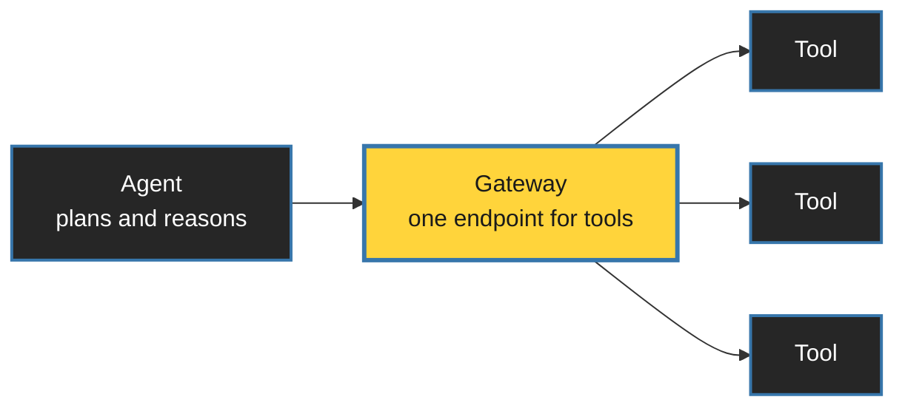
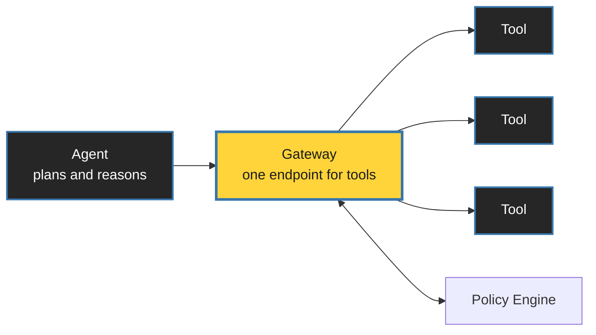
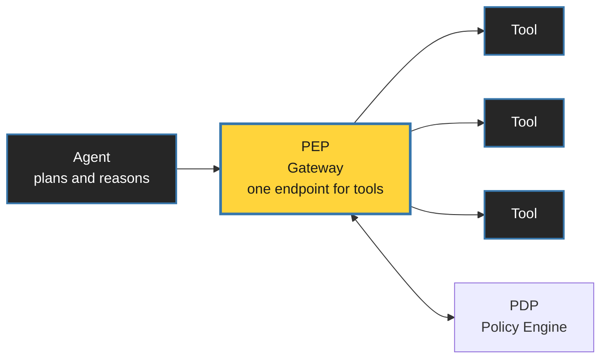
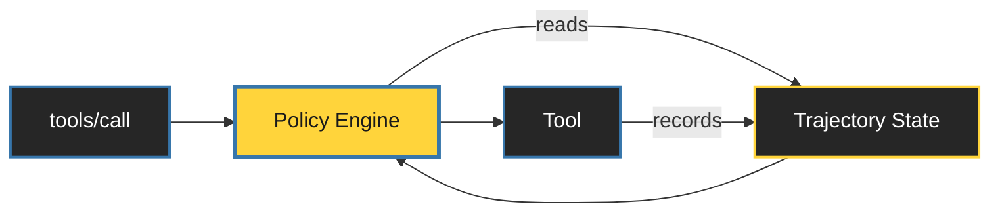

<style>
:root {
  --slidev-theme-primary: #FFFFFF;
  --slidev-theme-secondary: #FFD43B;
  --slidev-theme-accent: #3776AB;
  --slidev-theme-background: #1a1a1a;
  --slidev-theme-foreground: #E8E8E8;
  --slidev-code-background: rgba(13, 17, 23, 0.95);
}

/* ONE container treatment, used everywhere. */
.panel {
  background: #262626;
  border: 1px solid #3f3f3f;
  border-radius: 0.5rem;
  padding: 1.5rem;
}
.panel-yellow {
  background: #FFD43B;
  color: #1a1a1a;
  border-radius: 0.5rem;
  padding: 1.5rem;
  font-weight: 700;
}

.thesis {
  color: var(--slidev-theme-secondary);
  font-weight: 700;
  text-align: center;
}

/* For lines that need weight but are NOT the thesis. */
.beat { color: var(--slidev-theme-primary); text-align: center; }

.dim { color: #9ca3af; }

.mermaid { display: flex; justify-content: center; }

table.clean { width: 100%; border-collapse: collapse; }
table.clean td { padding: 0.75rem 1rem; border-bottom: 1px solid #3f3f3f; text-align: left; }
</style>


<div class="h-full flex flex-col justify-center items-center text-center">
  <h1 style="color: white !important; font-size: 3.75rem;">Agents Need a Cage</h1>
  <h2 style="color: white !important; background: transparent !important; margin-top: 1.5rem; font-weight: 400;">
    Governing AI with Amazon Bedrock AgentCore Policy
  </h2>
</div>

---

# Dream

<div class="text-center text-6xl mt-14 mb-14">
  🧑‍💻 <span class="mx-8 text-gray-600 text-4xl">→</span> 🤖
</div>

<div class="grid grid-cols-4 gap-8 text-center">
  <div>
    <div class="text-6xl">🎫</div>
    <div class="dim text-lg mt-3">tickets</div>
  </div>
  <div>
    <div class="text-6xl">📧</div>
    <div class="dim text-lg mt-3">email</div>
  </div>
  <div>
    <div class="text-6xl">🗄️</div>
    <div class="dim text-lg mt-3">databases</div>
  </div>
  <div>
    <div class="text-6xl">💳</div>
    <div class="dim text-lg mt-3">payments</div>
  </div>
</div>


---
layout: center
---

<div class="grid grid-cols-2 gap-8 mt-16">
  <div class="panel">
    <div class="text-5xl text-center mb-6">💸</div>
    <div class="text-xl dim mb-2">"Pay 1K to intern"</div>
    <div class="text-2xl font-mono">Done ✅ Sent $1000</div>
  </div>

  <div class="panel">
    <div class="text-5xl text-center mb-6">🗑️</div>
    <div class="text-xl dim mb-2">"Clean up completed tasks"</div>
    <div class="text-2xl font-mono">Deleted the project ✅</div>
  </div>
</div>

<div class="thesis text-3xl mt-16">
  Agents optimize for instructions, not consequences.
</div>


---
src: ./pages/about.md
---


---
layout: center
---

# Can't We Just Write a Better Prompt?

<div class="text-center text-4xl italic my-20 dim">
  "Never transfer more than Rs. 1000."
</div>

<div class="thesis text-3xl">
  A rule written only in prose is a wish.
</div>


---
layout: center
---

# We Already Solved This for Humans

<div class="flex items-center justify-center gap-12 mt-20">
  <div class="text-4xl px-6 py-4 rounded" style="background: #0d1117;">git push origin main</div>
  <div class="text-6xl">→</div>
  <div class="text-6xl">❌</div>
</div>

<div class="beat text-2xl mt-12">
  Branch protection · enforced by the platform, not the developer
</div>


---
transition: none
---

<div class="absolute inset-0">


</div>

<style>
.mermaid {
    transform: scale(1.55);
    transform-origin: top center;
    display: flex;
    justify-content: center;
    margin-top: 1.5rem;
}
</style>


---
transition: none
---

<div class="absolute inset-0">



</div>

<style>
.mermaid {
    transform: scale(1.55);
    transform-origin: top center;
    display: flex;
    justify-content: center;
    margin-top: 1.5rem;
}
</style>


---

<div class="absolute inset-0">



</div>

<style>
.mermaid {
    transform: scale(1.55);
    transform-origin: top center;
    display: flex;
    justify-content: center;
    margin-top: 1.5rem;
}
</style>


---

# Where the Agent Runs

<div class="space-y-4">
  <div class="panel flex items-center gap-8">
    <div class="text-4xl w-14 text-center">🧩</div>
    <div>
      <h3 class="m-0 text-2xl" style="color: var(--slidev-theme-secondary);">Harness</h3>
      <p class="m-0 text-xl dim">No container. No infra. Fastest path to running.</p>
    </div>
  </div>

  <div class="panel flex items-center gap-8">
    <div class="text-4xl w-14 text-center">🐳</div>
    <div>
      <h3 class="m-0 text-2xl" style="color: var(--slidev-theme-secondary);">Runtime</h3>
      <p class="m-0 text-xl dim">Your image → ECR → managed microVMs · invocations up to 8h</p>
    </div>
  </div>

  <div class="panel flex items-center gap-8">
    <div class="text-4xl w-14 text-center">⚙️</div>
    <div>
      <h3 class="m-0 text-2xl" style="color: var(--slidev-theme-secondary);">Runtime Instances</h3>
      <p class="m-0 text-xl dim">Your EC2 · you pick the silicon · sessions up to 14 days</p>
    </div>
  </div>
</div>

---
class: text-center
---

<div class="text-7xl font-bold">Policy</div>

<div class="text-3xl dim mt-8">Everything from here is about the cage.</div>


---

# Anatomy of a Decision

<div class="grid grid-cols-2 gap-6 mt-12">
  <div class="panel">
    <div class="text-sm dim uppercase tracking-widest mb-2">principal</div>
    <div class="text-2xl">Who is calling</div>
    <div class="text-base dim mt-2">from AgentCore Identity</div>
  </div>
  <div class="panel">
    <div class="text-sm dim uppercase tracking-widest mb-2">action</div>
    <div class="text-2xl">Which tool</div>
  </div>
  <div class="panel">
    <div class="text-sm dim uppercase tracking-widest mb-2">resource</div>
    <div class="text-2xl">Which gateway</div>
  </div>
  <div class="panel" style="border-color: #FFD43B;">
    <div class="text-sm uppercase tracking-widest mb-2" style="color: var(--slidev-theme-secondary);">context</div>
    <div class="text-2xl">arguments the model chose</div>
  </div>
</div>

<div class="text-center text-2xl dim mt-14">
  Identity settles <span style="color: var(--slidev-theme-secondary);">who</span>.
  Policy decides <span style="color: var(--slidev-theme-secondary);">what</span>.
</div>


---

# Deny by Default

```js
permit (
  principal == AgentCore::IamEntity::"{{LOOKUP_PRINCIPAL}}",
  action == AgentCore::Action::"Bank___get_client_profile",
  resource == AgentCore::Gateway::"{{BANK_GATEWAY_ARN}}"
);
```

<div class="panel-yellow text-center text-3xl mt-12 mx-auto" style="max-width: 34rem;">
  No policy → denied
</div>

<div class="text-center text-3xl dim mt-12" v-click>
  Cedar · open source · a CNCF project
</div>

<style>
  code {
    font-size: 1.45rem;
  }
</style>

---

# Fine-Grained: Which Arguments

```js
permit (
  principal is AgentCore::OAuthUser,
  action == AgentCore::Action::"RefundTool___process_refund",
  resource == AgentCore::Gateway::"<BANK_GATEWAY_ARN>"
) when {
  principal.hasTag("department") &&
  principal.getTag("department") == "finance" &&
  context.input.amount < 500 // arguments for process_refund
};
```

<div class="text-3xl mt-8 thesis">
  ABAC: Attribute-Based Access Control
</div>

<style>
  code {
    font-size: 1.45rem;
  }
</style>


---
layout: center
---

# Human in the Loop

<div class="text-center text-4xl mt-16 dim">
  Partly because some actions genuinely shouldn't be autonomous.
</div>

<v-click>
<div class="text-center text-4xl mt-10 dim">
  Mostly because we'd like to feel worthy and keep our jobs.
</div>
</v-click>

<v-after>
<div class="text-4xl mt-20 thesis">
  Either way, the approval has to become something the policy can read.
</div>
</v-after>


---

# Legitimately Correct in Isolation

<div class="space-y-5 mt-6 text-2xl">

<div class="panel">
    <div class="text-md uppercase tracking-widest dim mb-2">hallucinated id</div>
    Fetched, &nbsp; read <code>4321</code>, &nbsp; <span style="color: var(--slidev-theme-secondary);">transferred to <code>1234</code>.</span>
</div>
  <v-clicks>
    <div class="panel">
      <div class="text-md uppercase tracking-widest dim mb-2">No Total Limit</div>
      Pay 1000 every-day. &nbsp; <span style="color: var(--slidev-theme-secondary);">Executed 30 times in a day</span>
    </div>


<div class="panel">
    <div class="text-md uppercase tracking-widest dim mb-2">re-used HITL approval</div>
    Approval ID required for payment &nbsp; <span style="color: var(--slidev-theme-secondary);">Reused for multiple payments.</span>
</div>

  </v-clicks>
</div>


---

# Dogwood

<div class="text-left text-3xl dim mt-12">
  Open source · built on Cedar · <br/>
  Temporal Policy
</div>

<div class="h-32">
  
  
</div>

  <div v-after class="text-3xl">
    Stateless policies ask: <em>is this call allowed?</em>
  </div>

<v-after>
<div class="panel-yellow text-center text-3xl mt-6 mx-auto" style="max-width: 42rem;">
  Dogwood asks: is this call allowed <em>given what already happened?</em>
</div>
</v-after>

---

# Trajectories and Sessions



<div class="grid grid-cols-4 gap-4 mt-12 text-2xl" v-click>
    <div class="panel">You mint the session ID and send it on every request.</div>
  <div class="panel">Trajectory = Session ID + User Identity</div>
  <div class="panel">24-hour look-back window.</div>
  <div class="panel">Change the policies and open sessions are invalidated.</div>
</div>

<style>
.mermaid {
    transform: scale(1.25);
    transform-origin: top center;
    display: flex;
    justify-content: center;
}
</style>


---
class: pt-1 px-2
---

```js{none|1-4|5|6|7-9|11-19|11-13|14|15-17|11,12,13,19|all}
permit (
  principal == AgentCore::IamEntity::"{{LOOKUP_PRINCIPAL}}",
  action == AgentCore::Action::"BankTransfer___transfer_funds",
  resource == AgentCore::Gateway::"{{BANK_GATEWAY_ARN}}"
) when temporal {
  formerly within 15m AgentCore::Action::"BankProfile___get_client_profile"::response{
    output.account_number: context.input.to_account,
    output.profile_id:     context.input.profile_id,
    eventResource:         resource
  }
  && sum_within(
       amount,
       8h,
       AgentCore::Action::"BankTransfer___transfer_funds"::request{
         input.profile_id:   context.input.profile_id,
         eventResource:      resource
         input.amount:       amount,
       }
     ) <= 5000 };
```

<style>
  code {
    font-size: 1.15rem;
    margin-bottom: 2rem;
  }
</style>

---
layout: two-cols-header
---

# Demo Time

<svg width="100%" viewBox="0 0 800 100" xmlns="http://www.w3.org/2000/svg" role="img">

<defs>

<linearGradient id="plasmaGrad" x1="0" y1="1" x2="0" y2="0">
<stop offset="0%" stop-color="#001233"/>
<stop offset="35%" stop-color="#0466c8"/>
<stop offset="70%" stop-color="#48cae4"/>
<stop offset="100%" stop-color="#ffffff"/>
</linearGradient>
<radialGradient id="plasmaGlow" cx="50%" cy="50%" r="50%">
<stop offset="0%" stop-color="#48cae4" stop-opacity="0.6"/>
<stop offset="100%" stop-color="#48cae4" stop-opacity="0"/>
</radialGradient>

</defs>
<ellipse cx="400" cy="70" rx="380" ry="26" fill="url(#plasmaGlow)"/>
<g class="pf2 core" style="animation-delay:0.29s;animation-duration:0.6s"><path d="M1.2,100.0 C3.1,74.2 15.3,42.4 20.0,26.2 C24.7,46.9 36.9,77.9 38.8,100.0 Z" fill="url(#plasmaGrad)"/></g>
<g class="pf2 core" style="animation-delay:0.28s;animation-duration:0.8s"><path d="M24.9,100.0 C26.6,82.5 38.1,61.0 42.5,50.0 C46.9,64.0 58.4,85.0 60.1,100.0 Z" fill="url(#plasmaGrad)"/></g>
<g class="pf2 core" style="animation-delay:0.16s;animation-duration:0.82s"><path d="M45.3,100.0 C47.1,78.6 59.1,52.3 63.7,38.8 C68.3,55.9 80.2,81.6 82.1,100.0 Z" fill="url(#plasmaGrad)"/></g>
<g class="pf2 core" style="animation-delay:0.32s;animation-duration:0.77s"><path d="M69.8,100.0 C71.4,74.8 81.8,43.9 85.7,28.1 C89.7,48.2 100.0,78.4 101.6,100.0 Z" fill="url(#plasmaGrad)"/></g>
<g class="pf2 core" style="animation-delay:0.48s;animation-duration:0.61s"><path d="M87.9,100.0 C89.6,80.5 100.6,56.5 104.8,44.2 C109.0,59.8 120.0,83.3 121.7,100.0 Z" fill="url(#plasmaGrad)"/></g>
<g class="pf2 core" style="animation-delay:0.51s;animation-duration:0.63s"><path d="M107.3,100.0 C109.0,74.1 120.6,42.2 125.1,25.9 C129.5,46.6 141.1,77.8 142.9,100.0 Z" fill="url(#plasmaGrad)"/></g>
<g class="pf2 core" style="animation-delay:0.48s;animation-duration:0.68s"><path d="M127.8,100.0 C129.7,81.5 141.8,58.8 146.4,47.2 C151.1,62.0 163.2,84.2 165.0,100.0 Z" fill="url(#plasmaGrad)"/></g>
<g class="pf2 core" style="animation-delay:0.38s;animation-duration:0.62s"><path d="M154.4,100.0 C155.8,81.5 165.2,58.8 168.8,47.2 C172.3,62.0 181.7,84.2 183.1,100.0 Z" fill="url(#plasmaGrad)"/></g>
<g class="pf2 core" style="animation-delay:0.12s;animation-duration:0.76s"><path d="M168.9,100.0 C170.6,72.5 181.7,38.7 186.0,21.5 C190.3,43.5 201.4,76.4 203.1,100.0 Z" fill="url(#plasmaGrad)"/></g>
<g class="pf2 core" style="animation-delay:0.55s;animation-duration:0.71s"><path d="M187.0,100.0 C189.0,78.7 201.7,52.6 206.6,39.2 C211.4,56.2 224.1,81.8 226.1,100.0 Z" fill="url(#plasmaGrad)"/></g>
<g class="pf2 core" style="animation-delay:0.48s;animation-duration:0.89s"><path d="M212.1,100.0 C213.9,75.7 225.5,45.9 230.0,30.7 C234.5,50.1 246.1,79.2 247.9,100.0 Z" fill="url(#plasmaGrad)"/></g>
<g class="pf2 core" style="animation-delay:0.36s;animation-duration:0.62s"><path d="M235.9,100.0 C237.5,82.2 247.6,60.3 251.4,49.1 C255.3,63.4 265.4,84.7 267.0,100.0 Z" fill="url(#plasmaGrad)"/></g>
<g class="pf2 core" style="animation-delay:0.53s;animation-duration:0.71s"><path d="M256.5,100.0 C257.8,76.3 266.7,47.2 270.1,32.3 C273.5,51.3 282.3,79.7 283.7,100.0 Z" fill="url(#plasmaGrad)"/></g>
<g class="pf2 core" style="animation-delay:0.19s;animation-duration:0.58s"><path d="M268.8,100.0 C270.6,81.3 282.0,58.3 286.4,46.5 C290.8,61.5 302.3,83.9 304.1,100.0 Z" fill="url(#plasmaGrad)"/></g>
<g class="pf2 core" style="animation-delay:0.13s;animation-duration:0.85s"><path d="M293.6,100.0 C295.0,77.4 304.1,49.7 307.6,35.5 C311.1,53.6 320.2,80.6 321.6,100.0 Z" fill="url(#plasmaGrad)"/></g>
<g class="pf2 core" style="animation-delay:0.47s;animation-duration:0.51s"><path d="M311.3,100.0 C312.6,75.2 321.1,44.7 324.4,29.1 C327.6,48.9 336.1,78.7 337.5,100.0 Z" fill="url(#plasmaGrad)"/></g>
<g class="pf2 core" style="animation-delay:0.37s;animation-duration:0.62s"><path d="M320.7,100.0 C322.7,79.0 335.2,53.2 340.1,40.0 C344.9,56.8 357.5,82.0 359.4,100.0 Z" fill="url(#plasmaGrad)"/></g>
<g class="pf2 core" style="animation-delay:0.08s;animation-duration:0.9s"><path d="M347.5,100.0 C349.1,78.5 359.3,52.2 363.3,38.7 C367.2,55.8 377.4,81.6 379.0,100.0 Z" fill="url(#plasmaGrad)"/></g>
<g class="pf2 core" style="animation-delay:0.45s;animation-duration:0.66s"><path d="M366.2,100.0 C367.8,81.9 378.1,59.7 382.1,48.4 C386.1,62.8 396.5,84.5 398.1,100.0 Z" fill="url(#plasmaGrad)"/></g>
<g class="pf2 core" style="animation-delay:0.59s;animation-duration:0.86s"><path d="M386.6,100.0 C388.0,72.2 397.6,38.0 401.3,20.6 C405.0,42.8 414.5,76.2 416.0,100.0 Z" fill="url(#plasmaGrad)"/></g>
<g class="pf2 core" style="animation-delay:0.27s;animation-duration:0.83s"><path d="M399.7,100.0 C401.6,75.5 414.1,45.3 418.9,29.9 C423.8,49.5 436.3,79.0 438.2,100.0 Z" fill="url(#plasmaGrad)"/></g>
<g class="pf2 core" style="animation-delay:0.28s;animation-duration:0.78s"><path d="M425.4,100.0 C427.1,74.1 437.9,42.4 442.0,26.1 C446.2,46.8 457.0,77.8 458.6,100.0 Z" fill="url(#plasmaGrad)"/></g>
<g class="pf2 core" style="animation-delay:0.45s;animation-duration:0.61s"><path d="M448.4,100.0 C449.7,78.2 458.6,51.4 462.0,37.7 C465.4,55.2 474.2,81.3 475.6,100.0 Z" fill="url(#plasmaGrad)"/></g>
<g class="pf2 core" style="animation-delay:0.1s;animation-duration:0.51s"><path d="M459.8,100.0 C461.6,77.4 473.7,49.6 478.3,35.4 C482.9,53.5 494.9,80.6 496.8,100.0 Z" fill="url(#plasmaGrad)"/></g>
<g class="pf2 core" style="animation-delay:0.22s;animation-duration:0.6s"><path d="M483.3,100.0 C485.1,81.2 496.2,58.1 500.5,46.3 C504.8,61.3 515.9,83.9 517.6,100.0 Z" fill="url(#plasmaGrad)"/></g>
<g class="pf2 core" style="animation-delay:0.15s;animation-duration:0.66s"><path d="M501.5,100.0 C503.5,77.8 516.1,50.4 521.0,36.5 C525.9,54.2 538.6,80.9 540.5,100.0 Z" fill="url(#plasmaGrad)"/></g>
<g class="pf2 core" style="animation-delay:0.16s;animation-duration:0.69s"><path d="M527.1,100.0 C528.9,73.3 540.1,40.4 544.4,23.6 C548.7,45.0 560.0,77.1 561.7,100.0 Z" fill="url(#plasmaGrad)"/></g>
<g class="pf2 core" style="animation-delay:0.23s;animation-duration:0.62s"><path d="M551.2,100.0 C552.6,77.5 561.7,49.8 565.2,35.6 C568.7,53.7 577.8,80.7 579.1,100.0 Z" fill="url(#plasmaGrad)"/></g>
<g class="pf2 core" style="animation-delay:0.4s;animation-duration:0.89s"><path d="M566.7,100.0 C568.2,74.1 578.1,42.2 581.9,25.9 C585.8,46.6 595.7,77.8 597.2,100.0 Z" fill="url(#plasmaGrad)"/></g>
<g class="pf2 core" style="animation-delay:0.36s;animation-duration:0.63s"><path d="M584.6,100.0 C586.2,72.8 596.4,39.4 600.3,22.3 C604.2,44.1 614.3,76.7 615.9,100.0 Z" fill="url(#plasmaGrad)"/></g>
<g class="pf2 core" style="animation-delay:0.48s;animation-duration:0.87s"><path d="M602.6,100.0 C604.2,78.3 614.9,51.7 619.0,38.1 C623.1,55.4 633.8,81.4 635.4,100.0 Z" fill="url(#plasmaGrad)"/></g>
<g class="pf2 core" style="animation-delay:0.27s;animation-duration:0.52s"><path d="M625.7,100.0 C627.0,79.4 635.5,54.2 638.7,41.3 C642.0,57.7 650.5,82.4 651.8,100.0 Z" fill="url(#plasmaGrad)"/></g>
<g class="pf2 core" style="animation-delay:0.07s;animation-duration:0.79s"><path d="M636.0,100.0 C637.8,82.2 649.8,60.3 654.4,49.1 C659.0,63.3 670.9,84.7 672.8,100.0 Z" fill="url(#plasmaGrad)"/></g>
<g class="pf2 core" style="animation-delay:0.51s;animation-duration:0.52s"><path d="M656.9,100.0 C658.9,78.7 671.6,52.5 676.5,39.1 C681.4,56.2 694.1,81.7 696.0,100.0 Z" fill="url(#plasmaGrad)"/></g>
<g class="pf2 core" style="animation-delay:0.37s;animation-duration:0.67s"><path d="M680.3,100.0 C682.3,80.5 695.0,56.5 700.0,44.2 C704.9,59.8 717.6,83.3 719.6,100.0 Z" fill="url(#plasmaGrad)"/></g>
<g class="pf2 core" style="animation-delay:0.3s;animation-duration:0.69s"><path d="M704.8,100.0 C706.7,74.3 718.8,42.7 723.5,26.5 C728.2,47.1 740.3,78.0 742.2,100.0 Z" fill="url(#plasmaGrad)"/></g>
<g class="pf2 core" style="animation-delay:0.09s;animation-duration:0.75s"><path d="M730.4,100.0 C732.0,81.4 742.1,58.7 745.9,47.0 C749.8,61.8 759.9,84.1 761.5,100.0 Z" fill="url(#plasmaGrad)"/></g>
<g class="pf2 core" style="animation-delay:0.38s;animation-duration:0.54s"><path d="M750.6,100.0 C752.0,76.1 761.1,46.8 764.6,31.8 C768.1,50.9 777.2,79.5 778.6,100.0 Z" fill="url(#plasmaGrad)"/></g>
<path class="tendril" d="M132,56 L130,69 L135,75 L122,86 L107,89" fill="none" stroke="#90e0ef" stroke-width="1.5" stroke-linecap="round" style="animation-delay:0.55s"/>
<path class="tendril" d="M677,66 L676,72 L686,60 L702,73 L700,82" fill="none" stroke="#90e0ef" stroke-width="1.5" stroke-linecap="round" style="animation-delay:0.27s"/>
<path class="tendril" d="M248,58 L232,68 L249,61 L265,48 L278,41" fill="none" stroke="#90e0ef" stroke-width="1.5" stroke-linecap="round" style="animation-delay:0.58s"/>
<path class="tendril" d="M353,67 L336,54 L347,58 L349,43 L337,39" fill="none" stroke="#90e0ef" stroke-width="1.5" stroke-linecap="round" style="animation-delay:0.03s"/>
<path class="tendril" d="M735,61 L751,67 L746,54 L754,41 L756,40" fill="none" stroke="#90e0ef" stroke-width="1.5" stroke-linecap="round" style="animation-delay:0.3s"/>
<path class="tendril" d="M111,33 L112,18 L113,7 L105,-4 L107,-8" fill="none" stroke="#90e0ef" stroke-width="1.5" stroke-linecap="round" style="animation-delay:0.13s"/>
<path class="tendril" d="M211,53 L225,50 L213,44 L204,46 L214,49" fill="none" stroke="#90e0ef" stroke-width="1.5" stroke-linecap="round" style="animation-delay:0.11s"/>
<path class="tendril" d="M281,45 L279,42 L297,44 L303,51 L308,60" fill="none" stroke="#90e0ef" stroke-width="1.5" stroke-linecap="round" style="animation-delay:0.22s"/>
<path class="tendril" d="M513,69 L501,73 L497,59 L480,67 L467,74" fill="none" stroke="#90e0ef" stroke-width="1.5" stroke-linecap="round" style="animation-delay:0.06s"/>
<path class="tendril" d="M310,31 L312,40 L302,43 L317,36 L316,43" fill="none" stroke="#90e0ef" stroke-width="1.5" stroke-linecap="round" style="animation-delay:0.52s"/>
</svg>

::left::

<div class="flex flex-col h-full justify-start items-start pr-4 mt-1" v-click>
  <div class="text-3xl font-bold mb-2">Cedar with Harness</div>
  <p class="text-gray-400 mb-4 text-xl">Simple & stateless</p>
  <div class="w-full">
    <Youtube id="zBZM8a5QW4E" />
  </div>
</div>

::right::

<div class="flex flex-col h-full justify-start items-start pl-4 mt-1" v-click>
  <div class="text-3xl font-bold mb-2">Dogwood with Runtime</div>
  <p class="text-gray-400 mb-4 text-xl">Grounded in tool response + cumulative cap</p>
  <div class="w-full">
    <Youtube id="pZC0gTDv5SE" />
  </div>
</div>

<style>
.slidev-layout {
  padding: 40px 48px;
}
.two-cols-header {
  column-gap: 40px;
}
.two-cols-header .youtube-embed,
.two-cols-header iframe {
  width: 100% !important;
  aspect-ratio: 16 / 9;
  height: auto !important;
}

.core{animation:coreflick 0.4s ease-in-out infinite;}
@keyframes coreflick{0%,100%{opacity:1;}50%{opacity:0.7;}}
.tendril{stroke-dasharray:6 5;animation:crackle 0.6s linear infinite;}
@keyframes crackle{to{stroke-dashoffset:-22;}}
.pf2{transform-box:fill-box;transform-origin:50% 100%;animation-name:pf2flick;animation-timing-function:ease-in-out;animation-iteration-count:infinite;}
@keyframes pf2flick{0%,100%{transform:scaleY(1) skewX(0deg);}50%{transform:scaleY(1.2) skewX(2deg);}}
</style>
---

# So, Set Policy, And Chill


---
layout: center
---

# What Policy Will Not Do

<div class="space-y-5 mt-2 text-2xl">
  
  <div class="panel">It will not stop a tool that is dangerous by design.</div>
  <v-clicks>
    <div class="panel">It will not judge intent — only principal, action, resource, values.</div>
    <div class="panel">It will not fix a bad schema. Approve <code>amount</code> in paise, deny in rupees.</div>
    <div class="panel">It will not make an unreviewed policy correct.</div>
  </v-clicks>
</div>

<div class="thesis text-2xl mt-2" v-after>
  A cage is only as good as the bars you actually install.
</div>


---

# Takeaways

<div class="space-y-9 mt-16 text-3xl">
    <div>Tools give agents power.</div>
    <div>Prompts guide. Policies enforce.</div>
    <div>An approval is an event, not a credential.</div>
    <div style="color: var(--slidev-theme-secondary);" class="font-bold pt-8 border-t border-gray-700">
      Enforcement belongs outside the model.
    </div>
</div>

---
layout: center
---

# Try It

<div class="grid grid-cols-2 gap-16 mt-12 items-center">
  <div class="text-4xl space-y-6 dim ml-12">
    <div>Slides</div>
    <div>GitHub Repo</div>
    <div>Portfolio</div>
    <div>LinkedIn</div>
  </div>

  <div class="flex justify-center">
    
  </div>
</div>

---
layout: center
class: text-center
---

<div
  class="absolute inset-0 bg-cover bg-center z-0"
  style="background-image: url('/agentcore_policy/close_bg_image.png');"
></div>

<div class="relative z-10">
  <div
    class="text-5xl leading-relaxed font-bold text-white"
    style="text-shadow: 0 4px 20px rgba(0,0,0,0.8);"
  >
    Give your agent tools.<br/>
    <span style="color: var(--slidev-theme-secondary);">
      Don't give it unlimited power.
    </span>
  </div>
</div>