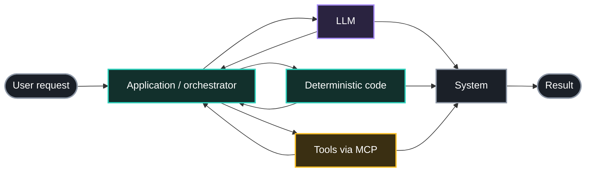
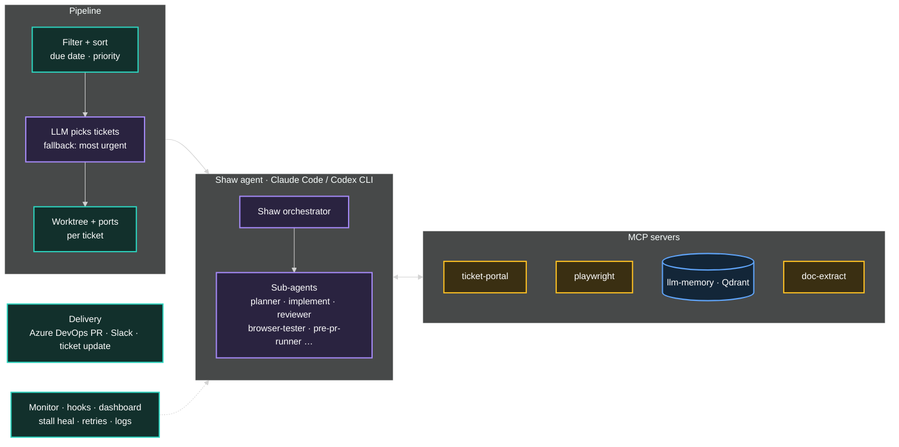
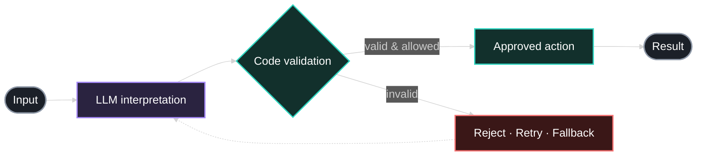

<PaeTheme />

  
Intelligence बैठक

  <h1 class="plain" style="font-size:3.4rem; line-height:1.1">
    Practical AI Engineering
  </h1>
  
From architecture to working systems

  
Susmit Vengurlekar

---

 
  

    
LLMs<small>interpret · generate</small>

    
+

    
Deterministic code<small>rules · validation · state</small>

    
+

    
Tools &amp; automation<small>APIs · browsers · MCP</small>

    
=

    
A working system

  

---
src: ./pages/disclaimer.md
---

---
src: ./pages/about.md
---

---

Today

# From AI concepts to working software

  
Understand<small>AI · LLMs · MCP · scale</small>

  
→

  
Architect<small>SHAW</small>

  
→

  
Integrate<small>tool choices · this deck</small>

  
→

  
Demonstrate<small>browser tester · ForQuiz</small>

  
→

  
Build<small>your own MCP tool</small>

---

Refresher

# The model is one component, not the whole application

---

Choose the right kind of work

# Don't give everything to the LLM

  

    <h3 class="llm">LLM</h3>
    <ul>
      <li>Messy text</li>
      <li>Drafting, rewriting, classifying, summarising</li>
      <li>Requests phrased a hundred different ways</li>
    </ul>
  

  

    <h3 class="code">Deterministic code</h3>
    <ul>
      <li>Exact calculations and business rules</li>
      <li>Validation and schemas</li>
      <li>Auth, permissions, critical state changes</li>
      <li>Retries and data integrity</li>
    </ul>
  

<v-click>

<b>Audience question:</b> Would you let an LLM calculate GST on an invoice? Why not?

</v-click>
---

Scale

# A demo that works once is not yet a reliable system

  
Latency

  
Reliability

  
Cost

  
Concurrency

  
Observability

  
Integrity &amp; safety

---
layout: center
---

Case study

<h1 class="plain" style="font-size:3.6rem">SHAW</h1>
---

# SHAW · Architecture

---

Architecture principle

# Keep the model useful, but keep the system in control

---

Integration lesson

# The best integration isn't always the most elaborate one

---

# This slide deck was also made with AI

  
Voice brainstorm<small>ChatGPT Voice Mode, walking around the house</small>

  
→

  
Structured outline<small>ChatGPT organises the raw ideas</small>

  
→

  
Markdown brief<small>slide-by-slide spec</small>

  
→

  
Slide agent<small>reads my repos, writes Slidev</small>

  
→

  
Deck<small>I review and edit. And delete half the slides</small>

---

# Two practical workflows

  

    <h3>CREATE · ForQuiz social content</h3>
    <ul class="small">
      <li>Pitch picked from our sales notes</li>
      <li>Agent plans slides, spoken lines, caption, hashtags</li>
      <li>Code builds the deck and renders PNGs</li>
      <li>Local TTS (Kokoro) voices the mascot · ffmpeg makes the reel</li>
    </ul>
  

  

    <h3>TEST · Browser tester</h3>
    <ul class="small">
      <li>Requirement + URL</li>
      <li>Agent builds a checklist, drives the browser via <b>Playwright MCP</b></li>
      <li>Code records, trims still frames, merges clips</li>
      <li>LLM writes narration · Piper TTS speaks it</li>
    </ul>
  

--- 

# Build systems, not just prompts

  

    
Slides

    
QA Agent Repo

    
Hands On Repo

    
Portfolio

    
LinkedIn

  

  

    
  

---

Hands-on · 30–40 min

# Your turn: a mini support agent + one MCP tool

  
Customer question<small>"where is ORD-101?"</small>

  
→

  
Pydantic AI agent<small>mock LLM → Gemini Flash</small>

  
→

  
lookup_order()<small>mock data · single source of truth</small>

  
←

  
MCP server<small>get_order</small>

